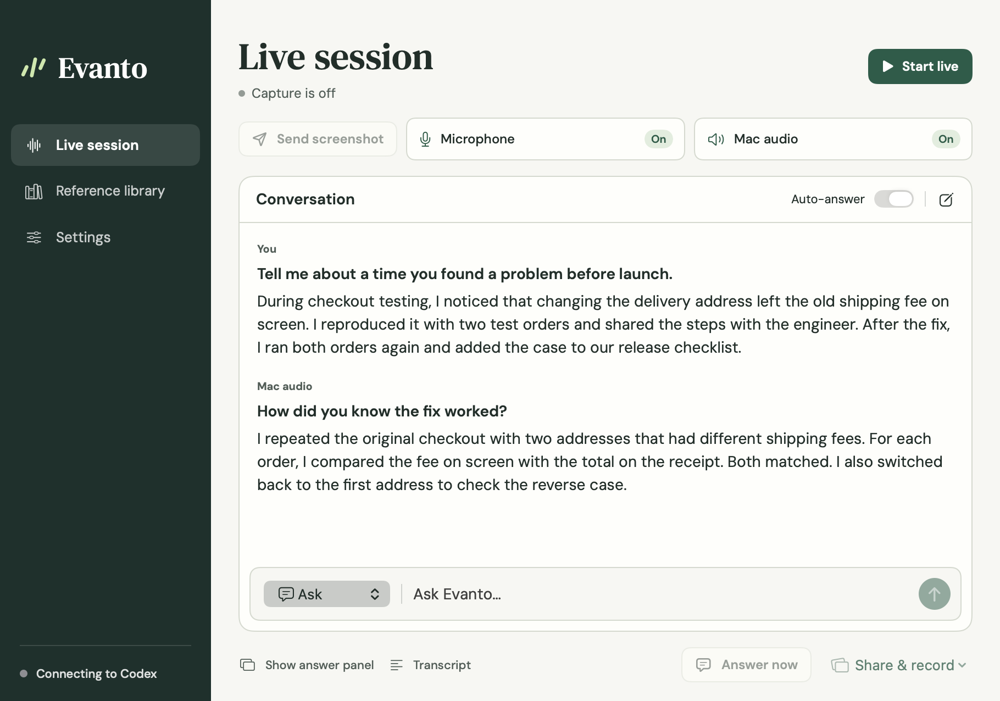
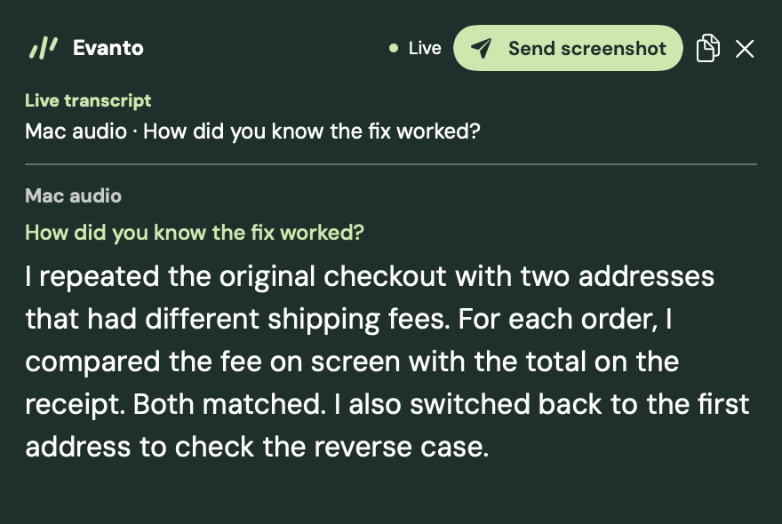

  
  
  
  

Evanto is an **AI interview assistant for Mac**. It supports **live captions in multiple languages** for questions you hear through your microphone or Mac audio. Select the language of the interview, follow the captions in the floating answer panel, and get written answers grounded in your CV and notes.

[Download for Apple silicon](https://github.com/sambhuiyan/evanto/releases/download/v1.5.0/Evanto-1.5.0-arm64.zip) · [Installation guide](docs/installation.md) · [Change the spoken language](docs/user-guide.md#change-the-spoken-language) · [User guide](docs/user-guide.md) · [GitHub releases](https://github.com/sambhuiyan/evanto/releases)

## Inside Evanto

**The workspace** keeps the interview question, written answer, and follow-up together. This sample conversation uses a fictional checkout test.

**The floating answer panel** shows the latest caption above the answer. The same follow-up is visible here while the rest of the desktop stays available.

## Your first conversation

1. Open **Evanto → Settings → Sign in with ChatGPT**. Your account supplies the available models.
2. In **Settings → Capture**, choose a display or window. Open **Spoken language** and select the language the interviewer will speak.
3. Choose **Start live**. Turn on **Mac audio** to listen to playback or **Microphone** to listen to someone nearby. You can mute either one mid-conversation.
4. Read the live transcript in the floating panel. With **Auto-answer** enabled, Evanto waits for a pause and answers grouped sentences together. **Answer now** submits the current passage immediately.

## What you can bring into a conversation

| Input | How to use it |
| --- | --- |
| Speech | Read separate captions for Mac playback and the microphone while an answer is on screen. Adjust the pause before answering in Settings. |
| A page on screen | Press **Send screenshot** when the page you want is visible. Each press attaches one still to the question. |
| A CV or notes | Import files in **Reference library**. Evanto draws on each saved reference across chats and selects relevant passages from longer documents. |
| A task on your Mac | Choose **Mac task**, select a working folder, and type the task. Select an app and grant Accessibility if the task also needs the cursor or keyboard. |

### Presenting in a meeting

Start Live, then choose **Entire Screen → Shared Screen** in the meeting’s picker. Some browsers call it **Screen 2**. This display carries the filtered desktop while the answer panel stays on your Mac. Sharing the built-in display directly can expose Evanto. Closing the local preview keeps the shared feed running. [Screen sharing and recording](docs/user-guide.md#share-or-record)

### Where your data goes

The Mac handles audio capture and transcription. Answering a question sends the prompt, relevant transcript and saved reference material to OpenAI through your own Codex session. A screenshot question also sends the selected frame. A typed Mac task can send the contents of files or window images it uses. Imported references persist locally until removed. [Context and storage](docs/user-guide.md#context-and-storage)

## License and acknowledgments

Developed by **Md Adnan Sami Bhuiyan**. Evanto’s original source and documentation are available under the [MIT License](LICENSE).

Evanto uses the OpenAI Codex CLI for sign-in and model access. Apple Speech and the bundled Whisper model power on-device captions. The speech notices credit the model authors and whisper.cpp contributors. The interface uses DM Sans and DM Serif Text. Each component retains its upstream license. [Codex notices](Packaging/Codex) · [Speech model and engine notices](Packaging/Speech) · [Font licenses](Packaging/Fonts)
